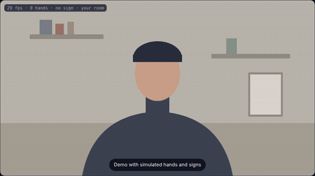

# signframe

Make a hand sign and the room behind you becomes an anime-style world. Then hold up
a frame with your hands and a character appears inside it; drop the frame and make
it again for the next one. It runs in the browser, and the camera image never leaves
your device.



_Demo mode. The person, hands and signs here are simulated so the page can be tried
without a camera; they run through the same recognition code as real hands._

> **Status: first version.** Demo mode is tested end to end. The camera path (real
> hands, real signs, real background cut-out) is written but has not been run yet,
> and the app ships with no trained signs: you teach it yours. See [Limits](#limits).

## What it does

- **Signs change the world.** Three signs, three worlds: Ember Valley, Storm Peak and
  Moon Shrine. Hold a sign for about half a second to enter its world; make the same
  sign again to return to your room.
- **The background is replaced, not you.** A segmentation model separates you from
  your room, and the world is drawn behind you.
- **The frame shows the cast.** Thumbs and index fingers make a four-cornered frame,
  and a character card is drawn inside it in perspective. Re-making the frame moves
  to the next of six original characters.
- **You teach the signs.** Record a few seconds of each sign with your own hands; the
  app learns from those examples in the browser. Examples can be saved to a file.
- **Keyboard:** `1` `2` `3` enter a world, `0` returns to the room, `N` next
  character, `H` shows or hides the hand points.

## How it works

```
camera frame
   ├─▶ hand landmarker ──▶ 21 points per hand
   │        ├─▶ features: each hand moved to its wrist and scaled by its own size,
   │        │   plus how the two hands sit relative to each other (87 numbers)
   │        │        └─▶ k-nearest-neighbour classifier ─▶ "flame 100%" / "no sign"
   │        │                 └─▶ detector: held for 450 ms, fires once, needs a
   │        │                     release before firing again ─▶ switch world
   │        └─▶ thumb + index tips ─▶ frame corners (smoothed) ─▶ which card to show
   └─▶ selfie segmenter ──▶ person mask
                                └─▶ canvas: world, then the cut-out person,
                                    then the card warped into the frame
```

- **Features that ignore position and distance.** A sign should be the same sign
  whether you stand near or far, left or right, so the raw points are never compared
  directly. `src/features.js` has tests for exactly that.
- **Why k-nearest-neighbour.** It needs no training step, so teaching a sign in the
  browser is instant, and "nothing like any example" falls out naturally as "no
  sign" through a distance limit. With only a few hundred examples it is also fast
  enough to run every frame.
- **One event per sign.** A classifier guesses 30 times a second. `SignDetector`
  turns that into single events: the same guess for 450 ms, then silence until the
  hands relax or change.
- **A sign is not a frame.** Hands held together also make a small four-cornered
  shape. A frame only counts when it is big enough, no sign is recognised, and it has
  been held for a moment, so cards do not flash while your hands move into place.
- **Perspective on a 2D canvas.** A 2D canvas can only stretch and skew, so the card
  is cut into a grid of small triangles and each is drawn with its own transform
  (`src/warp.js`), using the same homography maths as
  [handframe](https://github.com/tasniamoumi/handframe).

## Run it

```bash
npm install
npm run dev        # http://localhost:5173
npm test           # 44 unit tests
npm run build      # static site in dist/
```

The camera needs a secure page: `localhost` or `https`.

## Use your own characters

The cast is a "pack": `public/pack/pack.json` lists the cards in order. A card is
either drawn by the app (`"art": "builtin:rei"`) or an image file you put in
`public/pack/`:

```json
{ "name": "Hana", "title": "Storm caller", "art": "hana.png", "colors": ["#123154", "#3b9ae1"] }
```

Images are cropped to fill a 640 × 400 card, and the name and title are drawn over
them. Use only images you have the right to use, especially in anything you publish.

## Project layout

```
src/features.js    hands → numbers that ignore position and distance      (tested)
src/classifier.js  k-NN classifier, sign detector, hold-out self-check     (tested)
src/show.js        which world is on; what counts as a frame               (tested)
src/cards.js       card cycling, pack validation                           (tested)
src/warp.js        perspective drawing with a triangle mesh                (tested)
src/frame.js       frame corners, homography, smoothing                    (tested)
src/demo.js        simulated person, hands and signs                       (tested)
src/art.js         the six characters, drawn in code
src/worlds.js      the three worlds, drawn in code
src/compose.js     world + cut-out person + card on one canvas
src/segment.js     MediaPipe selfie segmenter
src/tracking.js    MediaPipe hand landmarker
src/main.js        start-up, the frame loop, teaching, controls
```

## Limits

- **The camera path has not been run.** Hand tracking uses the same code as
  handframe, which works on a real webcam. The background cut-out and real sign
  recognition are new and untested with a camera. If the cut-out comes out inverted,
  tick "Swap cut-out".
- **No signs are built in.** `public/model/signs.json` is empty. Until you teach your
  signs, use the keyboard or the buttons. Shipping a ready-made model needs recordings
  from several people, which do not exist yet.
- **The numbers are not measured on real hands.** The distance limit, hold time and
  minimum frame size were chosen on the simulated poses. The in-app self-check score
  is optimistic, because examples from one recording are very alike.
- **Hand tracking loses hands that overlap or interlock.** Signs where the hands
  cover each other will be unreliable; signs with both hands clearly visible work
  best.
- **The cut-out is rough at the edges.** Hair and fingers can flicker or show a halo.
- Two models are downloaded from Google's model host on first use (about 8 MB).
  Without a connection to it, only demo mode works.
- Tested in a headless Chromium only. Not yet tried on phones or Safari.

## Credit

Hand tracking and segmentation are [MediaPipe](https://ai.google.dev/edge/mediapipe/solutions/guide).
The characters and worlds are original to this project.

## Licence

MIT
